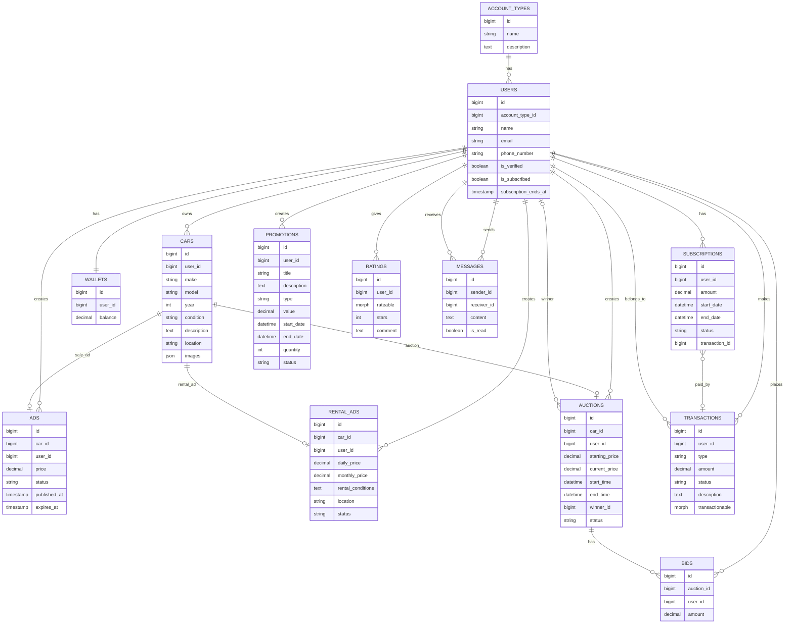
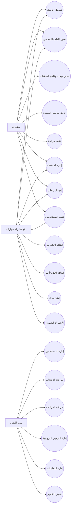
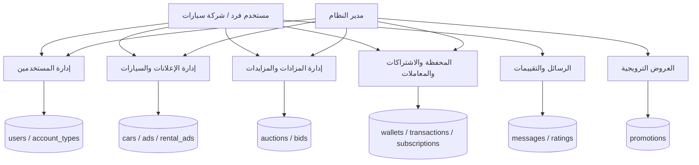
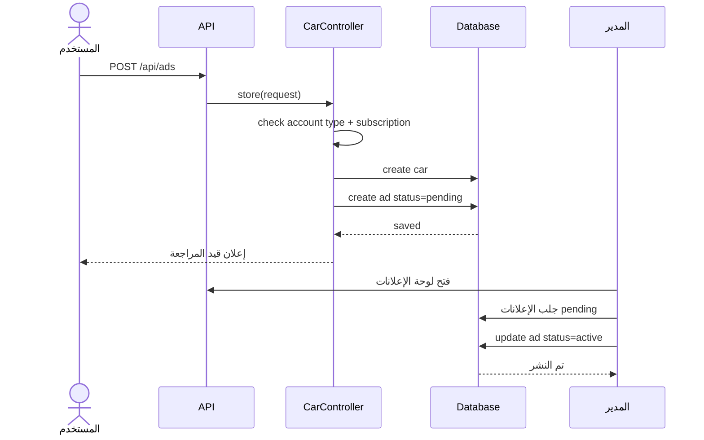
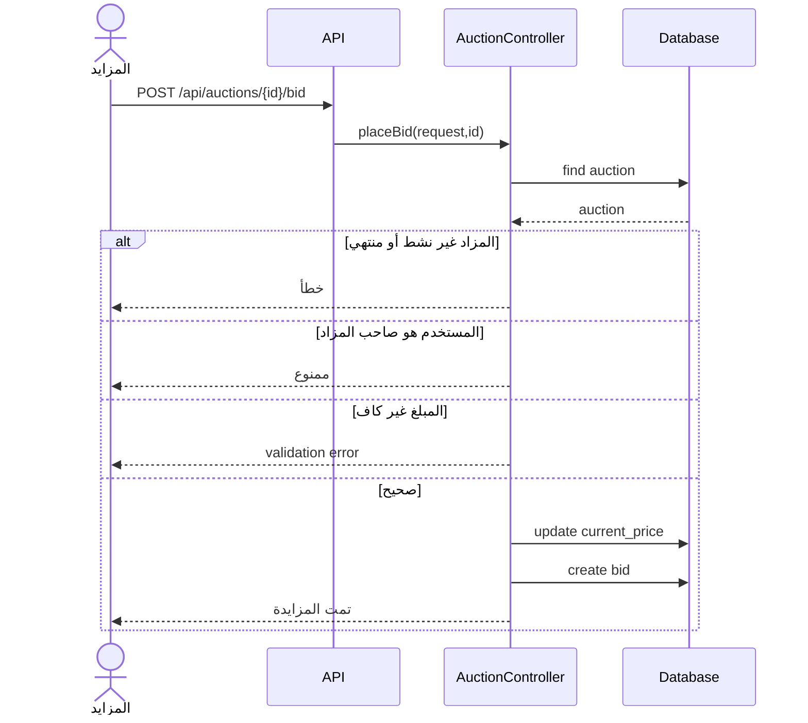

# تقرير الفحص الشامل لمشروع Syria Motor بعد حذف الورش

**اسم التقرير:** فحص المتطلبات والمخططات والعلاقات بعد حذف الورش  
**نطاق الفحص:** نسخة المشروع المتاحة في الملف `syria_motor_no_workshops.zip` داخل بيئة العمل.  
**نوع الفحص:** فحص Static Code Review للملفات: `routes`, `controllers`, `models`, `migrations`, `seeders`, `views`, بالإضافة إلى مقارنة المتطلبات والسيناريو والمخططات المرفوعة.  
**ملاحظة مهمة:** إذا كنت عدّلت ملفات على جهازك بعد إنشاء/رفع هذه النسخة، فهذا التقرير لا يرى تعديلات جهازك إلا إذا رفعت نسخة جديدة. التقرير أدناه مبني على النسخة المتاحة داخل `/mnt/data/syria_motor_no_workshops.zip`.

---

## 1. مصادر الفحص

اعتمد الفحص على الملفات التالية:

1. المشروع بعد حذف الورش: `syria_motor_no_workshops.zip`.
2. سيناريو الاستخدام: `Project_Scenario.md` و `Project_Scenario.html`.
3. المتطلبات الوظيفية: `المتطلبات الوظيفية2.pdf`.
4. وثيقة المتطلبات العامة: `المستند (1).pdf`.
5. وثيقة فكرة التطبيق ونموذج العمل: `سوريا موتورز.pdf`.
6. المخططات:
   - `class diagram(1).svg`
   - `dfd.svg`
   - `erd diagram.svg`
   - `Sequence diagram.svg`
   - `use case.svg`

---

## 2. الخلاصة التنفيذية

### 2.1 نتيجة حذف الورش

تم فحص المشروع بعد حذف الورش باستخدام بحث شامل داخل:

```text
app/
database/
resources/
routes/
```

ولم تظهر أي بقايا تنفيذية لهذه الكلمات:

```text
Workshop
ServiceRequest
workshops
service_requests
service-requests
workshop_id
service_request
```

**النتيجة:** حذف الورش وطلبات الخدمة من الكود الأساسي نظيف في النسخة المفحوصة.

لكن توجد مشكلة مهمة: **ملفات المتطلبات والسيناريو والمخططات ما زالت تحتوي الورش، طلبات الخدمة، والفاحص الفني**. لذلك يوجد عدم تطابق بين التحليل/التوثيق وبين الكود الحالي.

---

### 2.2 حالة المشروع العامة

المشروع حالياً يحتوي على نواة قوية لهذه الميزات:

- تسجيل ودخول API باستخدام Sanctum.
- حسابات مستخدمين بأنواع: `individual`, `company`, `admin`.
- إعلانات بيع سيارات.
- إعلانات تأجير سيارات.
- مزادات ومزايدات.
- محفظة إلكترونية وشحن وسحب.
- اشتراكات شهرية مرتبطة بالمحفظة.
- لوحة تحكم مدير.
- رسائل وتقييمات وعروض ترويجية كجداول وموديلات.

لكن المشروع **ليس مطابقاً بالكامل للمتطلبات**. يوجد قسم من المتطلبات مطبق، قسم مطبق جزئياً، وقسم غير مطبق.

أهم المشاكل التقنية المكتشفة:

1. مسارات Admin كثيرة تستدعي `create/store` غير موجودة داخل الكنترولرات.
2. صفحة تعديل المزاد تحتوي كود رسائل بالخطأ وتستخدم `$messages` داخل `admin/auctions/edit.blade.php`.
3. نظام المزادات في Admin يستخدم أسماء حقول وحالات لا تطابق قاعدة البيانات: `start_price` بدل `starting_price`، و `completed` بدل `closed`.
4. نظام الرسائل في Admin لا يطابق جدول `messages`: يستخدم `subject/body/read_at` بينما الجدول يستخدم `content/is_read`.
5. نظام العروض الترويجية في Admin لا يطابق جدول `promotions`: يستخدم `discount_percentage/fixed_discount_amount/is_active` بينما الجدول يستخدم `type/value/quantity/status`.
6. نظام المعاملات في Admin يستخدم حقول غير موجودة مثل `payment_method` و `transaction_date`.
7. مسارات إعادة تعيين كلمة المرور في API تشير إلى دالة غير موجودة: `sendResetLinkEmail`.
8. `PasswordController` الخاص بالويب لا يحتوي `update` رغم أن `routes/auth.php` يستدعيه.
9. علاقة `account_type_id` في migration مضافة بالخطأ داخل `down()` وليس `up()`.
10. الاختبارات الافتراضية غالباً ستفشل لأن `UserFactory` لا يملأ `account_type_id` المطلوب.

---

## 3. بنية المشروع بعد حذف الورش

### 3.1 Controllers

```text
app/Http/Controllers/
├── Api/
│   ├── AuthController.php
│   ├── CarController.php
│   ├── RentalAdController.php
│   ├── AuctionController.php
│   ├── WalletController.php
│   └── SubscriptionController.php
│
├── Admin/
│   ├── DashboardController.php
│   ├── UserController.php
│   ├── AdController.php
│   ├── RentalAdController.php
│   ├── AuctionController.php
│   ├── TransactionController.php
│   ├── PromotionController.php
│   ├── MessageController.php
│   └── RatingController.php
│
├── Auth/
└── ProfileController.php
```

### 3.2 Models

```text
AccountType
User
Car
Ad
RentalAd
Auction
Bid
Wallet
Transaction
Subscription
Promotion
Message
Rating
```

لا توجد Models للورش أو طلبات الخدمة بعد الحذف.

### 3.3 الجداول الموجودة بعد حذف الورش

```text
account_types
users
cars
ads
rental_ads
auctions
bids
wallets
transactions
subscriptions
promotions
messages
ratings
personal_access_tokens
password_reset_tokens
failed_jobs
```

لا توجد جداول:

```text
workshops
service_requests
```

---

## 4. فحص مطابقات المسارات مع الكنترولرات

### 4.1 مسارات Admin المكسورة

تمت مقارنة `routes/admin.php` مع دوال الكنترولرات داخل `app/Http/Controllers/Admin`.

المسارات التالية موجودة لكن الدوال غير موجودة:

| Controller | Method مفقودة | الأثر |
|---|---|---|
| `UserController` | `create` | فتح `/admin/users/create` يسبب خطأ |
| `UserController` | `store` | إرسال إنشاء مستخدم من Admin يسبب خطأ |
| `AdController` | `create` | فتح `/admin/ads/create` يسبب خطأ |
| `AdController` | `store` | إرسال إنشاء إعلان بيع من Admin يسبب خطأ |
| `RentalAdController` | `create` | فتح `/admin/rental-ads/create` يسبب خطأ |
| `RentalAdController` | `store` | إرسال إنشاء إعلان تأجير من Admin يسبب خطأ |
| `AuctionController` | `create` | فتح `/admin/auctions/create` يسبب خطأ |
| `AuctionController` | `store` | إرسال إنشاء مزاد من Admin يسبب خطأ |
| `TransactionController` | `create` | فتح `/admin/transactions/create` يسبب خطأ |
| `TransactionController` | `store` | إرسال إنشاء معاملة من Admin يسبب خطأ |
| `RatingController` | `create` | فتح `/admin/ratings/create` يسبب خطأ |
| `RatingController` | `store` | إرسال إنشاء تقييم من Admin يسبب خطأ |

**مكان الإصلاح:**

إما حذف هذه المسارات من:

```text
routes/admin.php
```

إذا كان المدير لا ينشئ هذه البيانات، أو إضافة الدوال والصفحات المقابلة داخل الكنترولرات و `resources/views/admin/.../create.blade.php`.

### 4.2 مسارات API المكسورة

في `routes/api.php` يوجد:

```php
Route::post('/forgot-password', [PasswordController::class, 'sendResetLinkEmail']);
```

لكن `app/Http/Controllers/Auth/PasswordController.php` لا يحتوي الدالة `sendResetLinkEmail`. الموجود هو:

```php
forgot()
reset()
```

**الإصلاح المقترح:**

إما تعديل route إلى:

```php
Route::post('/forgot-password', [PasswordController::class, 'forgot']);
```

أو إضافة دالة `sendResetLinkEmail` داخل `PasswordController`.

### 4.3 مسار ويب مكسور لتحديث كلمة المرور

في `routes/auth.php` يوجد:

```php
Route::put('password', [PasswordController::class, 'update'])->name('password.update');
```

لكن `PasswordController` الموجود لا يحتوي `update()`.

**الأثر:** صفحة تحديث كلمة المرور من Profile قد تفشل.

**الإصلاح:** إرجاع `PasswordController` الخاص بـ Breeze أو إضافة دالة `update()` المناسبة.

---

## 5. فحص قاعدة البيانات والعلاقات

### 5.1 العلاقات الصحيحة الموجودة

| العلاقة | الحالة |
|---|---|
| `User belongsTo AccountType` | موجودة |
| `AccountType hasMany Users` | موجودة |
| `User hasMany Cars` | موجودة |
| `Car belongsTo User` | موجودة |
| `Car hasOne Ad` | موجودة |
| `Car hasOne RentalAd` | موجودة |
| `Car hasOne Auction` | موجودة |
| `Ad belongsTo Car/User` | موجودة |
| `RentalAd belongsTo Car/User` | موجودة |
| `Auction belongsTo Car/User/Winner` | موجودة |
| `Auction hasMany Bids` | موجودة |
| `Bid belongsTo Auction/User` | موجودة |
| `User hasOne Wallet` | موجودة |
| `User hasMany Transactions` | موجودة |
| `Transaction morphTo transactionable` | موجودة |
| `Rating morphTo rateable` | موجودة |
| `Message belongsTo sender/receiver` | موجودة |
| `User hasMany sent/received messages` | موجودة |
| `User hasMany subscriptions` | موجودة |

### 5.2 مشكلة علاقة نوع الحساب

Migration:

```text
database/migrations/2025_07_10_105310_add_account_type_foreign_key_to_users_table.php
```

يحتوي علاقة `account_type_id` داخل `down()` وليس داخل `up()`.

الحالي:

```php
public function up(): void
{
    Schema::table('users', function (Blueprint $table) {
        // فارغ
    });
}

public function down(): void
{
    Schema::table('users', function (Blueprint $table) {
        $table->foreign('account_type_id')...
    });
}
```

**المشكلة:** عند تشغيل migrations، العلاقة لا تُنشأ فعلياً.

**الإصلاح:** نقل `foreign()` إلى `up()`، وفي `down()` يتم حذف القيد.

---

## 6. فحص المتطلبات الوظيفية حسب المشتري

مصدر هذه المتطلبات هو ملف المتطلبات الوظيفية الذي يذكر وظائف المشتري مثل التصفح، البحث، الحجز، الدفع، التقييم، المزادات، والإشعارات.

| رقم | المتطلب | الحالة الحالية | أين موجود/أين يطبق | المطلوب إن لم يكن مطبقاً |
|---:|---|---|---|---|
| 1 | تصفح السيارات باستخدام فلاتر الماركة/السعر/المدينة/الحالة/الموديل | مطبق جزئياً | `Api/CarController@index`, `RentalAdController@index` | إضافة فلترة أوسع مثل السنة والمسافة والنوع والكهربائية |
| 2 | ترتيب السيارات حسب الأقل سعراً/الأعلى/الأحدث | غير مطبق | لا يوجد `sort` واضح | إضافة `sort=price_asc/price_desc/latest` في `CarController@index` و `RentalAdController@index` |
| 3 | عرض قائمة السيارات المنشورة | مطبق جزئياً | `GET /api/ads`, `GET /api/rental-ads` | جيد، لكن يعرض فقط active افتراضياً |
| 4 | البحث بكلمة مفتاحية | جزئي | البحث منفصل حسب `make/model/location` | إضافة `q` يبحث في `make`, `model`, `description`, `location` |
| 5 | فلترة السعر/النوع/الحالة | جزئي | السعر والحالة موجودان، النوع كـ make/model | إضافة type/category إذا أردت فئات أوسع |
| 6 | عرض تفاصيل السيارة | مطبق جزئياً | `CarController@show`, `RentalAdController@show`, `AuctionController@show` | لا يوجد تقرير فحص ولا فيديو |
| 7 | إضافة إعلان إلى المفضلة | غير مطبق | لا يوجد جدول `favorites` | إنشاء `favorites` migration + model + API routes |
| 8 | التواصل مع الموظف واتساب/اتصال | غير مطبق | لا يوجد endpoint | إضافة حقول تواصل/زر واتساب أو دعم داخلي |
| 9 | حجز تجربة قيادة/معاينة | غير مطبق | لا يوجد جدول حجز | إنشاء `reservations` أو `test_drives` |
| 10 | عرض السيارات المحجوزة وتنبيه انتهاء الحجز | غير مطبق | لا يوجد | يحتاج جدول حجوزات + Scheduler + Notifications |
| 11 | اختيار طريقة الدفع إلكتروني/نقدي | جزئي | `WalletController` يدعم شحن/سحب، لا يدعم شراء سيارة | إضافة `payments/orders` وربطها بـ Ad/Auction/RentalAd |
| 12 | عرض إيصال بعد الدفع | غير مطبق | لا يوجد Receipt model/view/pdf | إنشاء إيصالات مرتبطة بـ `transactions` |
| 13 | تقييم من 1 إلى 5 | جزئي | جدول `ratings` وموديل موجودان | لا يوجد API للمستخدم لإنشاء تقييم |
| 14 | عرض التقييمات | جزئي | Admin فقط | إضافة API: `GET /api/users/{id}/ratings` |
| 15 | إنشاء حساب بالبريد وكلمة المرور | مطبق | `Api/AuthController@register`, Breeze web auth | جيد، لكن لا يوجد Google/Facebook |
| 16 | تسجيل الدخول | مطبق | `Api/AuthController@login`, Web login | جيد |
| 17 | تعديل الملف الشخصي | جزئي | Web `ProfileController` | لا يوجد API لتعديل الملف ولا صورة شخصية |
| 18 | تصفح المزادات | مطبق جزئياً | `GET /api/auctions` | جيد للمزادات active، يحتاج تقارير/فلترة أوسع |
| 19 | تقديم عرض سعر على المزاد | مطبق | `AuctionController@placeBid` | لا يوجد خصم عربون أو تحقق رصيد |
| 20 | متابعة حالة المزاد | جزئي | `AuctionController@show` | لا يوجد watchlist أو إشعارات |
| 21 | استلام إشعار عند الفوز | غير مطبق | لا يوجد Notifications مفعلة | إضافة Laravel Notifications عند إغلاق المزاد |
| 22 | إتمام الدفع بعد الفوز | غير مطبق | لا يوجد settlement flow | إضافة checkout بعد `winner_id` |

---

## 7. فحص متطلبات البائع

| رقم | المتطلب | الحالة | أين موجود/أين يطبق | المطلوب |
|---:|---|---|---|---|
| 1 | إنشاء حساب كبائع فردي أو معرض | مطبق جزئياً | `account_type = individual/company` | لا يوجد distinction واضح بين مشتري وبائع؛ الحساب الفردي يؤدي الدورين |
| 2 | إضافة إعلان بيع سيارة | مطبق API | `POST /api/ads` في `CarController@store` | جيد، يحتاج صور/فيديو/تقرير فحص حسب المتطلبات |
| 3 | تعديل/حذف الإعلانات | مطبق API | `CarController@update/destroy` | جيد للمالك |
| 4 | حجز موعد للفحص | غير مطبق | لا يوجد inspection tables/controllers | إذا أبقيت الفحص: `inspection_requests`, `inspection_reports` |
| 5 | تعديل الملف الشخصي | جزئي | Web Profile فقط | إضافة API وصورة مستخدم |
| 6 | نشر سيارة كمزاد مع سعر ابتدائي ووقت انتهاء | مطبق API | `AuctionController@store` | جيد، لكن Admin views مكسورة |
| 7 | متابعة العروض المقدمة | جزئي | `AuctionController@show` يعرض bids | يحتاج واجهة للبائع وترتيب/تنبيهات |
| 8 | الموافقة/الرفض على السعر النهائي | غير مطبق | لا يوجد field أو endpoint | إضافة حالة قبول البائع بعد انتهاء المزاد |
| 9 | إتمام البيع بعد انتهاء المزاد والقبول | غير مطبق | لا يوجد sale/order flow | إضافة `orders/sales` وربطها بالدفع والعمولة |

---

## 8. فحص متطلبات المدير

| رقم | المتطلب | الحالة | أين موجود/أين يطبق | المطلوب |
|---:|---|---|---|---|
| 1 | إدارة حسابات المستخدمين | جزئي | `Admin/UserController@index/show/edit/update/destroy` | يوجد حذف وتعديل، لكن لا يوجد create/store رغم وجود routes؛ لا يوجد suspend field |
| 2 | مراجعة وتعديل/حذف الإعلانات | جزئي | `Admin/AdController`, `Admin/RentalAdController` | عرض/تعديل/حذف موجود، create/store مكسور، وقد تحتاج approve/reject buttons أو status active/rejected |
| 3 | إدارة العروض الترويجية والإعلانات المدفوعة | مكسور في النسخة المفحوصة | `PromotionController` و views لا تطابق الجدول | توحيد الحقول مع `type/value/quantity/status/user_id` |
| 4 | استلام طلبات البيع ونشرها | جزئي | الإعلانات تبدأ `pending`، المدير يغير status | جيد جزئياً، يحتاج notifications/queue |
| 5 | تمييز سيارات كعروض مميزة مقابل رسوم | غير مطبق | لا يوجد `featured` في ads/cars | إضافة أعمدة `is_featured`, `featured_until`, وربطها بالمعاملات |
| 6 | إرسال إشعارات عروض جديدة مطابقة للاهتمامات | غير مطبق | لا توجد preferences أو notifications | إضافة `user_preferences`, Notifications, Jobs |
| 7 | إرسال طلبات الفحص للفني | غير مطبق بعد حذف الورش | لا توجد inspection modules | إذا بقي الفحص ضمن النطاق، أضفه كنظام مستقل عن الورش |
| 8 | تقارير إحصائية عن المستخدمين والعروض | جزئي | `DashboardController` يعرض counts بسيطة | إضافة تقارير مفصلة ومخططات وتصدير |
| 9 | مراجعة إعلانات المزاد قبل النشر | جزئي | المزاد يبدأ `pending`، Admin update status | لكن Admin Auction مكسور بسبب `start_price`/`completed` |
| 10 | تنبيهات المهتمين بمزادات | غير مطبق | لا يوجد watchlist/notifications | إضافة `auction_watchers` + Notifications |
| 11 | تقارير مزادات: عدد/أسعار/نسبة نجاح | غير مطبق | لا يوجد | إضافة `AuctionReportController` أو dashboard metrics |

---

## 9. فحص متطلبات الفاحص الفني

المتطلبات المرفوعة تتضمن فاحصاً فنياً يستلم طلبات فحص ويرفع تقارير ويحدث الحالة. بعد حذف الورش، **الفاحص الفني غير مطبق أيضاً**.

| المتطلب | الحالة | أين يطبق إذا أردت إضافته |
|---|---|---|
| استلام طلبات الفحص من الأدمن | غير مطبق | `inspection_requests` + `Admin/InspectionRequestController` + `Api/InspectorController` |
| إجراء فحص شامل وتوثيق النتائج | غير مطبق | `inspection_reports` table |
| تحميل تقارير الفحص | غير مطبق | storage + `inspection_report_path` |
| تحديث حالة الفحص | غير مطبق | `status = pending/accepted/rejected/needs_repair` |

**قرار مطلوب منك:** هل الفحص الفني بقي ضمن المشروع بعد حذف الورش أم تريد حذفه أيضاً؟ لأن السيناريو والمتطلبات والمخططات ما زالت تعتمد عليه.

---

## 10. مقارنة المتطلبات العامة في المستندات

### 10.1 إدارة المستخدمين والصلاحيات

| البند | الحالة |
|---|---|
| تسجيل بالبريد وكلمة المرور | مطبق |
| تسجيل Google/Facebook | غير مطبق |
| تحقق البريد | جزئي؛ routes موجودة لكن `User` لا يطبّق `MustVerifyEmail` ولا يوجد فرض واضح |
| تحقق رقم الهاتف | غير مطبق |
| استعادة كلمة المرور | Web موجود من Breeze، API route مكسور |
| تعديل البيانات الشخصية | Web جزئي، لا صورة، API غير موجود |
| أدوار عادي/بائع مميز/مدير | جزئي عبر `account_types` واشتراك، لا توجد صلاحيات دقيقة |
| تعطيل الحسابات المخالفة | غير مطبق؛ لا يوجد `status/suspended_at` |

### 10.2 إدارة السيارات والعروض

| البند | الحالة |
|---|---|
| سيارة للبيع | مطبق API |
| سيارة للإيجار | مطبق API |
| المقايضة | غير مطبق |
| رفع صور | مطبق جزئياً |
| رفع فيديوهات | غير مطبق |
| تقرير فحص السيارة | غير مطبق |
| فلترة متقدمة | جزئية |
| تجديد العروض المنتهية | غير مطبق |
| العروض المميزة المدفوعة | غير مطبق/العروض الترويجية موجودة لكن لا تربط السيارات |

### 10.3 التواصل والتقييمات

| البند | الحالة |
|---|---|
| دردشة مباشرة بائع/مشتري | غير مطبق فعلياً؛ الرسائل موجودة في Admin فقط ولا يوجد API محادثات |
| إرسال استفسارات حول السيارة | غير مطبق كـ API |
| حفظ سجل المحادثات | جدول messages موجود، لكنه لا يربط الرسالة بسيارة/إعلان |
| تقييم البائعين بالنجوم | جزئي؛ جدول Rating يدعم polymorphic User |
| تعليقات نصية | مطبق في الجدول |
| عرض تقييمات البائع | غير مطبق API/User UI |

### 10.4 الدفع والمعاملات

| البند | الحالة |
|---|---|
| حجز السيارة | غير مطبق |
| الدفع الإلكتروني | جزئي عبر Wallet fake/manual |
| إيصال إلكتروني | غير مطبق |
| ربط شركات التمويل | غير مطبق |
| حساب العمولة تلقائياً | موجود كدالة `WalletController::deductCommission` لكن غير مستدعاه عند إتمام البيع |
| إشعار بالعموالت | غير مطبق |

### 10.5 لوحة التحكم والتقارير

| البند | الحالة |
|---|---|
| إحصاءات المستخدمين والعروض | جزئي في `DashboardController` |
| مراقبة المحتوى وحذف المخالفات | جزئي عبر Admin CRUD |
| إدارة الإعلانات المدفوعة | غير مكتملة |
| تقارير المبيعات والإيجارات | غير مطبق |
| تحليل سلوك المستخدمين | غير مطبق |
| تصدير البيانات | غير مطبق |

### 10.6 ميزات إضافية

| البند | الحالة |
|---|---|
| إشعارات حسب الاهتمامات | غير مطبق |
| تنبيهات انتهاء العروض/الحجوزات | غير مطبق |
| تطبيق موبايل | API جزئي يدعم موبايل مستقبلاً، لا يوجد تطبيق |
| Push Notifications | غير مطبق |
| نظام إحالة | غير مطبق |

---

## 11. مقارنة نموذج العمل

وثيقة سوريا موتورز تذكر مصادر دخل مثل العمولة على الصفقات، الاشتراكات الشهرية، الإعلانات المدفوعة، وبيع البيانات التحليلية.

| مصدر دخل | الحالة الحالية | ملاحظات |
|---|---|---|
| عمولة على الصفقات | جزئي جداً | دالة موجودة لكنها لا تعمل تلقائياً لأن إتمام الصفقة غير مطبق |
| اشتراكات شهرية للبائعين | مطبق جزئياً | الاشتراك يخصم من المحفظة ويفتح إضافة الإعلانات والمزادات |
| إعلانات مدفوعة | غير مكتمل | جدول promotions موجود لكن لا يميز إعلانات سيارات فعلياً |
| بيانات تحليلية | غير مطبق | لا يوجد analytics/export |

---

## 12. فحص المخططات بعد حذف الورش

### 12.1 Class Diagram

المخطط الحالي ما زال يحتوي:

```text
Workshop
ServiceRequest
```

وهذا لم يعد مطابقاً للمشروع بعد الحذف.

كما توجد اختلافات أخرى:

| في المخطط | في الكود الحالي |
|---|---|
| `Message.subject`, `Message.body` | `messages.content`, `messages.is_read` |
| `Auction.ends_at` | `auctions.end_time` |
| `Auction.starting_price` | موجود، لكن Admin views تستخدم `start_price` خطأ |
| `RentalAd.terms` | `rental_conditions` |
| `Subscription.plan` | `amount`, `transaction_id`, `status` |
| `Workshop/ServiceRequest` | محذوفان من الكود |

### 12.2 ERD

الـ ERD الحالي يحتوي `workshops` و `service_requests`؛ يجب حذفهما. كما يجب تعديل `messages` و `subscriptions` و `rental_ads` و `auctions` لتطابق migrations الحالية.

### 12.3 DFD

الـ DFD الحالي يحتوي:

```text
P5 إدارة الخدمات
Workshops / Service Requests
طلب خدمة
حالة الطلب
```

بعد حذف الورش يجب حذف هذه العملية والمخزن المرتبط بها. إذا أبقيت الفحص الفني، يمكن استبدال P5 بـ:

```text
P5 إدارة الفحص الفني
Inspection Requests / Inspection Reports
```

### 12.4 Use Case

الـ Use Case الحالي يحتوي:

```text
طلب خدمة
إدارة طلبات الخدمات
تقييم مستخدم/ورشة
مستخدم شركة/ورشة
```

بعد حذف الورش يجب تغييره إلى:

```text
تقييم مستخدم/بائع
مستخدم فرد/شركة سيارات
```

وحذف:

```text
طلب خدمة
إدارة طلبات الخدمات
ورشة
```

### 12.5 Sequence Diagram

المخطط يذكر اعتماد الإعلان باستخدام status `approved`، بينما الكود يستخدم غالباً:

```text
pending
active
sold
rejected
```

لذلك يجب تغيير `approved` إلى `active` أو تعديل الكود ليقبل `approved` كحالة موحدة.

---

## 13. مخطط ERD محدث مقترح بعد حذف الورش



---

## 14. Use Case محدث مقترح بعد حذف الورش



---

## 15. DFD محدث مقترح بعد حذف الورش



---

## 16. Sequence Diagram محدث لإضافة إعلان واعتماده



---

## 17. Sequence Diagram محدث للمزايدة



---

## 18. أخطاء تفصيلية يجب إصلاحها قبل اعتبار المشروع مكتمل

### 18.1 صفحة تعديل المزاد تحتوي كود رسائل

الملف:

```text
resources/views/admin/auctions/edit.blade.php
```

المحتوى الحالي يبدأ بـ:

```text
Manage Messages
List of Messages
@foreach($messages as $message)
```

وهذا خطأ لأن صفحة المزاد يجب أن تستخدم `$auction` وليس `$messages`.

**الأثر:**

```text
Undefined variable $messages
```

**الإصلاح:** استبدال محتوى الملف بفورم تعديل مزاد، أو عرض المزايدات عبر:

```blade
@foreach($auction->bids as $bid)
```

### 18.2 Admin Auction يستخدم حقول غير موجودة

الملفات:

```text
app/Http/Controllers/Admin/AuctionController.php
resources/views/admin/auctions/index.blade.php
resources/views/admin/auctions/show.blade.php
```

يستخدم:

```text
start_price
completed
```

بينما قاعدة البيانات والموديل يستخدمان:

```text
starting_price
closed
```

**الإصلاح:** توحيد الاسم إلى `starting_price` وتوحيد الحالة إلى `closed` أو تعديل جميع الأكواد إلى `completed` لكن الأفضل استخدام `closed` لأنه موجود في API وSeeder وmigration.

### 18.3 Admin Message لا يطابق جدول messages

الملفات:

```text
app/Http/Controllers/Admin/MessageController.php
resources/views/admin/messages/create.blade.php
resources/views/admin/messages/edit.blade.php
resources/views/admin/messages/index.blade.php
resources/views/admin/messages/show.blade.php
```

تستخدم:

```text
subject
body
read_at
```

بينما الجدول يستخدم:

```text
content
is_read
```

**الإصلاح:** تحويل `body` إلى `content`، واستبدال `read_at` بـ `is_read`. إذا تريد `subject` فعلياً، أضف عمود `subject` في migration.

### 18.4 Admin Promotions لا يطابق جدول promotions

الملفات:

```text
app/Http/Controllers/Admin/PromotionController.php
resources/views/admin/promotions/*.blade.php
```

تستخدم:

```text
discount_percentage
fixed_discount_amount
is_active
```

بينما الجدول يستخدم:

```text
type
value
quantity
status
user_id
```

**الإصلاح:** تعديل controller والviews لتستخدم أسماء الجدول الصحيحة، وإضافة:

```php
$validated['user_id'] = auth()->id();
```

### 18.5 Admin Transactions لا يطابق جدول transactions

الملفات:

```text
app/Http/Controllers/Admin/TransactionController.php
resources/views/admin/transactions/*.blade.php
```

تستخدم:

```text
payment_method
transaction_date
deposit
withdrawal
payment
refund
```

بينما الجدول يستخدم:

```text
type: charge/debit/withdrawal_request/commission/subscription_payment
status: completed/pending/failed
created_at بدل transaction_date
description
transactionable
```

**الإصلاح:** إزالة `payment_method` و `transaction_date` أو إضافتهما للجدول، وتوحيد أنواع المعاملات.

### 18.6 Admin create/store routes مكسورة

راجع القسم 4.1.

### 18.7 مشكلة `WalletController`

في `show()` يتم إنشاء wallet إذا لم توجد. لكن في `charge()` و `withdraw()` لا توجد حماية من كون `$wallet = null`.

**الإصلاح:** إضافة:

```php
if (!$wallet) {
    $wallet = $user->wallet()->create(['balance' => 0]);
}
```

داخل `charge()` و `withdraw()`.

### 18.8 الدفع الوهمي

`Sham Cash API` حالياً وهمي:

```php
return (object)['success' => true]
```

والكود اليدوي يقبل فقط:

```text
12345
```

هذا مناسب للديمو فقط وليس نظام دفع حقيقي.

---

## 19. متطلبات محذوفة أو يجب إعادة تعريفها بعد حذف الورش

بما أنك قررت حذف الورش، يجب تعديل المتطلبات والسيناريو والمخططات لإزالة:

```text
الورش
طلبات الخدمة
خدمات ما بعد البيع من الورش
تقييم الورش
إدارة طلبات الخدمات
مستخدم شركة/ورشة
```

لكن يبقى عندك قراران:

### القرار الأول: هل تريد حذف الفاحص الفني أيضاً؟

إذا نعم، احذف:

```text
طلب الفحص
الفاحص الفني
تقرير الفحص
شارة مفحوصة
```

من المتطلبات والمخططات.

إذا لا، طبّقه كنظام مستقل عن الورش:

```text
inspection_requests
inspection_reports
technical_inspectors
```

### القرار الثاني: ما معنى التقييمات بعد حذف الورش؟

الأفضل تحويلها إلى:

```text
تقييم المستخدمين / البائعين / المشترين
```

بدل تقييم الورش.

---

## 20. خريطة تطبيق المتطلبات الناقصة

| المتطلب الناقص | ملفات/جداول التطبيق المقترحة |
|---|---|
| المفضلة | `favorites` migration, `FavoriteController`, `routes/api.php` |
| حجز معاينة/تجربة قيادة | `reservations` أو `test_drives`, `ReservationController` |
| تقرير فحص فني | `inspection_requests`, `inspection_reports`, `InspectionController` |
| إشعارات | Laravel Notifications, `database_notifications`, Jobs/Scheduler |
| دفع سيارة/مزاد | `orders`, `payments`, `receipts`, ربطها بـ Wallet |
| إيصال إلكتروني | `receipts` table + PDF/HTML receipt view |
| إتمام البيع | `sales` أو `orders` + حالات workflow |
| قبول/رفض السعر النهائي | حقول داخل `auctions`: `seller_decision`, `accepted_at` |
| العروض المميزة | أعمدة في `ads`: `is_featured`, `featured_until` |
| الإعلانات المدفوعة | `paid_ad_packages`, `ad_payments` |
| فرز نتائج البحث | تعديل `index()` في `CarController`, `RentalAdController`, `AuctionController` |
| محادثة بائع/مشتري | `ConversationController`, `conversations`, ربط message بـ conversation/ad |
| API تقييمات | `Api/RatingController` + routes |
| نظام الإحالة | `referrals` table, referral_code في users |
| تقارير Dashboard | `Admin/ReportController`, charts, exports |
| Google/Facebook login | Laravel Socialite |
| فيديوهات السيارات | `videos` json في cars أو جدول `car_media` |
| تعطيل الحسابات | `users.status`, `suspended_at`, middleware |

---

## 21. أولوية الإصلاح المقترحة

### المرحلة 1: إصلاح الأخطاء التي تسبب runtime errors

1. حذف/إضافة `create/store` في Admin routes/controllers.
2. إصلاح `admin/auctions/edit.blade.php`.
3. توحيد `starting_price` في كل ملفات المزادات.
4. إصلاح MessageController وviews.
5. إصلاح PromotionController وviews.
6. إصلاح TransactionController وviews.
7. إصلاح PasswordController routes.
8. إصلاح migration علاقة `account_type_id`.

### المرحلة 2: توحيد التحليل والمخططات بعد حذف الورش

1. تحديث السيناريو وحذف فصل خدمات ما بعد البيع المرتبط بالورش.
2. تحديث Use Case وحذف طلب الخدمة.
3. تحديث ERD/Class/DFD وحذف Workshop/ServiceRequest.
4. تحديد مصير الفاحص الفني.

### المرحلة 3: إكمال المتطلبات الأساسية

1. المفضلة.
2. الحجز/المعاينة.
3. الدفع الحقيقي/الإيصالات.
4. إتمام البيع/المزاد.
5. الإشعارات.
6. API للتقييمات والرسائل.
7. التقارير.

### المرحلة 4: تحسينات متقدمة

1. Social Login.
2. Referral system.
3. Video uploads.
4. Analytics/export.
5. Push Notifications.

---

## 22. أوامر فحص يمكنك تشغيلها محلياً

### التأكد من حذف الورش

```powershell
findstr /s /i "Workshop ServiceRequest workshops service-requests workshop_id" *.php *.blade.php
```

يجب أن لا يظهر شيء من ملفات المشروع الأساسية.

### التأكد من مسارات Admin

```powershell
php artisan route:list | findstr /i "admin/users/create admin/auctions/create admin/ads/create admin/rental-ads/create"
```

إذا ظهرت routes، تأكد أن الدوال موجودة داخل controller.

### فحص دوال create/store

```powershell
findstr /n /i "function create function store" app\Http\Controllers\Admin\UserController.php
findstr /n /i "function create function store" app\Http\Controllers\Admin\AuctionController.php
findstr /n /i "function create function store" app\Http\Controllers\Admin\AdController.php
```

### فحص بقايا حقول الرسائل القديمة

```powershell
findstr /s /i "subject body read_at" app\Http\Controllers\Admin\MessageController.php resources\views\admin\messages\*.blade.php
```

### فحص بقايا حقول العروض القديمة

```powershell
findstr /s /i "discount_percentage fixed_discount_amount is_active" app\Http\Controllers\Admin\PromotionController.php resources\views\admin\promotions\*.blade.php
```

### فحص أخطاء المزادات

```powershell
findstr /s /i "start_price completed messages" app\Http\Controllers\Admin\AuctionController.php resources\views\admin\auctions\*.blade.php
```

---

## 23. الحكم النهائي

المشروع بعد حذف الورش أصبح أقرب إلى منصة:

```text
بيع سيارات + تأجير سيارات + مزادات + محفظة + اشتراكات + رسائل + تقييمات + عروض ترويجية + لوحة مدير
```

لكن حسب المتطلبات والمخططات المرفوعة، المشروع لا يزال غير مكتمل. الميزات الأساسية المطبقة جيدة كبداية، خصوصاً الإعلانات والمزادات والاشتراكات، لكن توجد فجوة واضحة في:

- الحجز.
- المفضلة.
- الفحص الفني.
- الدفع الحقيقي وإتمام البيع.
- الإشعارات.
- الدردشة بين بائع ومشتري.
- التقارير.
- توافق Admin views/controllers مع قاعدة البيانات.
- توافق المخططات مع الكود بعد حذف الورش.

**تقييمي العملي:** المشروع مناسب كـ MVP أولي بعد إصلاح الأخطاء الحرجة، لكنه لا يحقق كل المتطلبات الوظيفية الكاملة بعد.

الأولوية الآن ليست إضافة ميزات جديدة مباشرة، بل أولاً توحيد:

```text
routes + controllers + views + migrations + diagrams + requirements
```

ثم إكمال الميزات الناقصة حسب الأولوية.
